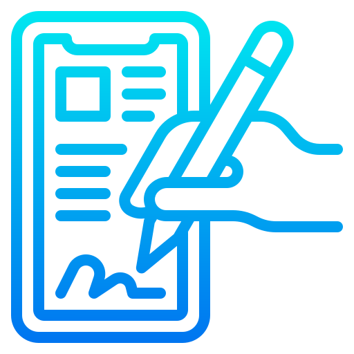

<a name="readme-top"></a>

<br />
<div align="center">
  <a href="https://github.com/mmdanny89/pdf-signer">
    
  </a>

<h3 align="center">PDF Signer</h3>

  <p align="center">
    Simple application for signing PDF files with Electronic Certificates in Frappe and Erpnext.
    <br />
    <a href="https://github.com/mmdanny89/pdf-signer"><strong>Explore the docs »</strong></a>
    <br />
    <br />
    <a href="https://github.com/mmdanny89/pdf-signer/issues/new?labels=bug&template=bug-report---.md">Report Bug</a>
    ·
    <a href="https://github.com/mmdanny89/pdf-signer/issues/new?labels=enhancement&template=feature-request---.md">Request Feature</a>
  </p>
</div>


<!-- TABLE OF CONTENTS -->
<details>
  <summary>Table of Contents</summary>
  <ol>
    <li>
      <a href="#about-the-project">About PDF Signer</a>
    </li>
    <li>
      <a href="#getting-started">Getting Started</a>
      <ul>
        <li><a href="#installation">Installation</a></li>
      </ul>
    </li>
    <li><a href="#usage">Usage</a></li>
    <li><a href="#license">License</a></li>
  </ol>
</details>


<!-- ABOUT THE PROJECT -->
## About PDF Signer

[![Product Name Screen Shot][product-screenshot]](https://github.com/mmdanny89/pdf-signer)

PDF Signer is an application that allows you to apply electronic signatures to a PDF document. Among its main characteristics are:
1. Allows you to apply multiple signatures using digital certificates on the same PDF document.
2. Allows you to apply a single digital signature to a document. After this, if the PDF document is modified, they will not be valid.
3. Validate the signatures applied to a PDF document with certificates of type `Certification Authority, (CA Root)`.
4. Customize the signature: Use a background image, QR code, apply on one or more pages in the document, etc...
5. When attaching a PDF document to any doctype in the system, automatically ask if you want to sign it.
6. Multiple signature configuration environments.
7. Manage multiple certificate chain.

<p align="right">(<a href="#readme-top">back to top</a>)</p>


<!-- GETTING STARTED -->
## Getting Started

To get a local copy up and running follow these simple example steps.


### Installation

### Install on Frappe Cloud

1. Go to https://frappecloud.com/dashboard/#/sites and click the "New Site" button.
2. In Step 2 ("Select apps to install"), select "PDF Signer".
3. Complete the new site wizard.

### Install on Self-Hosted
Version 16
```bash
cd frappe-bench
bench get-app --branch version-16 https://github.com/mmdanny89/pdf-signer.git
bench --site sitename install-app pdf_signer
```
> Remember to replace `sitename` with your site name.<br>
> For Version 15: `bench get-app --branch version-15 https://github.com/mmdanny89/pdf-signer.git`.<br>
> For Version 14: `bench get-app --branch main https://github.com/mmdanny89/pdf-signer.git`.

### Contributing

This app uses `pre-commit` for code formatting and linting. [Install pre-commit](https://pre-commit.com/#installation) and enable it for this repository:

```bash
cd apps/pdf_signer
pre-commit install
```

Pre-commit uses these tools to check and format the code:

- ruff
- eslint
- prettier

<p align="right">(<a href="#readme-top">back to top</a>)</p>


<!-- USAGE EXAMPLES -->
## Usage

| Guide | Content |
|---|---|
| [Configuration](docs/configuration.md) | Install, certificate containers, sign settings, signature box, global settings |
| [Signing and verifying](docs/signing.md) | Sign a PDF, sign when you attach a PDF, verify the signatures |
| [Desk](docs/desk.md) | Apps screen, desktop, dock, sidebar, workspace and icons |
| [Development](docs/development.md) | Structure, pre-commit, linters, tests and branches |
| [Decisions](docs/decisions.md) | The decisions of the version for Frappe 16, and the known limits |

For Frappe 14 and 15, refer to the [Wiki Usage](https://github.com/mmdanny89/pdf-signer/wiki/Usage).

<p align="right">(<a href="#readme-top">back to top</a>)</p>


<!-- LICENSE -->
## License

Distributed under the MIT License. See `LICENSE` for more information.

<p align="right">(<a href="#readme-top">back to top</a>)</p>


[product-screenshot]: images/pdf-signer-dashboard.png
